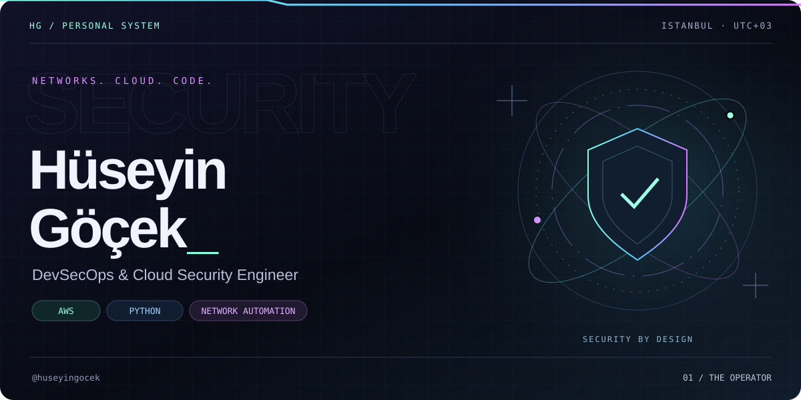
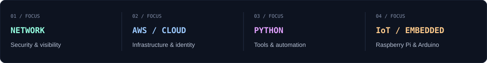
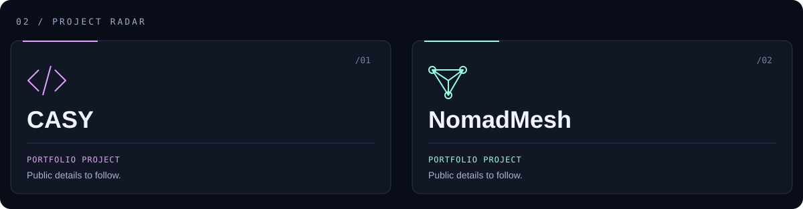

  

  <a href="cv/Huseyin-Gocek-CV.pdf"><b>VIEW CV ↗</b></a> &nbsp; · &nbsp;
  <a href="https://www.linkedin.com/in/huseyingocek/"><b>LINKEDIN ↗</b></a> &nbsp; · &nbsp;
  <a href="https://github.com/huseyingocek?tab=repositories"><b>REPOSITORIES ↗</b></a> &nbsp; · &nbsp;
  <b>ISTANBUL, TÜRKİYE</b>

 

### Understand the network. Engineer the defense.

I'm **Hüseyin**, a **DevSecOps & Cloud Security Engineer** exploring the intersection of network security, cloud infrastructure, and automation. My interests include **AWS**, **Python tooling**, and connected systems built with **Raspberry Pi and Arduino**.

Currently at **LumivantaX**, with experience across **Fortinet, Cisco, Palo Alto, AWS, Linux, and Python automation**. I also deliver hands-on training in networking and web application security.

**[View CV](cv/Huseyin-Gocek-CV.pdf)** · **[Download PDF](https://github.com/huseyingocek/huseyingocek/raw/refs/heads/main/cv/Huseyin-Gocek-CV.pdf)** · [Read as text](cv/CV.md)

  

 

  

**CASY / Caravan Aura System** — An IoT project bringing energy and battery management, sensor monitoring, remote control, and automation into one platform for smarter caravan living.

**NomadMesh** — An offline mesh communication project using BLE discovery, Wi-Fi Direct data transfer, and store-and-forward messaging. Designed for end-to-end encrypted communication when internet access is unavailable, including disaster scenarios.

Both projects were prepared for TÜBİTAK 2209 applications and IEEE-related work.

 

 

<b>LESS NOISE. MORE SIGNAL.</b> NETWORKS &nbsp; / &nbsp; CLOUD &nbsp; / &nbsp; AUTOMATION

