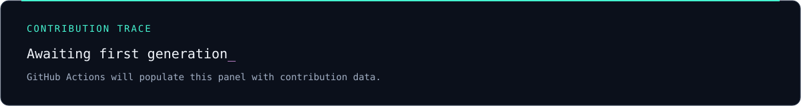

  

  <a href="https://github.com/huseyingocek">GitHub</a> &nbsp; / &nbsp;
  <a href="https://www.linkedin.com/in/huseyingocek/">LinkedIn</a> &nbsp; / &nbsp;
  Istanbul, Türkiye

## 01 / Operator

I'm **Hüseyin Göçek**, a DevSecOps & Cloud Security Engineer focused on networks, cybersecurity, and automation.

My interests connect **AWS**, **Python automation**, and the infrastructure behind reliable systems. I also explore IoT and embedded systems with Raspberry Pi and Arduino.

**Understand the network. Reduce the noise. Automate the repeatable.**

## 02 / Focus map

| Domain | Areas of interest |
| :--- | :--- |
| **Network & cybersecurity** | Network visibility · security workflows · infrastructure |
| **Cloud / AWS** | Cloud security · identity and access · secure infrastructure |
| **Python automation** | Repeatable tasks · tooling · network automation |
| **IoT & embedded** | Raspberry Pi · Arduino · connected systems |

## 03 / Project radar

**RiskCore** &nbsp; / &nbsp; **ThreatGraph** &nbsp; / &nbsp; **CASY**

These are projects in my portfolio. Public repository links and technical write-ups will be added when available to share.

## 04 / Contribution trace

  

Generated from GitHub contribution data after the first successful workflow run.

---

NETWORKS / CLOUD / AUTOMATION Build with intent. Keep learning.

