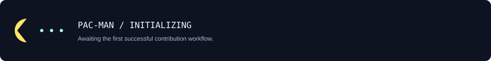

  

  <a href="cv/Huseyin-Gocek-CV.pdf"><b>VIEW CV ↗</b></a> &nbsp; · &nbsp;
  <a href="https://www.linkedin.com/in/huseyingocek/"><b>LINKEDIN ↗</b></a> &nbsp; · &nbsp;
  <a href="https://github.com/huseyingocek?tab=repositories"><b>REPOSITORIES ↗</b></a> &nbsp; · &nbsp;
  <b>ISTANBUL, TÜRKİYE</b>

 

### Understand the network. Engineer the defense.

I'm **Hüseyin**, a **DevSecOps & Cloud Security Engineer** exploring the intersection of network security, cloud infrastructure, and automation. My interests include **AWS**, **Python tooling**, and connected systems built with **Raspberry Pi and Arduino**.

Currently at **LumivantaX**, with experience across **Fortinet, Cisco, Palo Alto, AWS, Linux, and Python automation**. I also deliver hands-on training in networking and web application security.

**[View CV](cv/Huseyin-Gocek-CV.pdf)** · **[Download PDF](https://github.com/huseyingocek/huseyingocek/raw/refs/heads/main/cv/Huseyin-Gocek-CV.pdf)** · [Read as text](cv/CV.md)

  

 

  

<b>Project notes / publication status</b>

 

**CASY** and **NomadMesh** are projects in my portfolio. Technical descriptions and repository links will appear here when available to share.

 

### Contribution arcade / Pac-Man

<picture>
  <source media="(prefers-color-scheme: dark)" srcset="assets/pacman-contribution-graph-dark.svg" />
  
</picture>

My contribution calendar, arcade edition. Refreshed daily.

<b>Bonus / contribution snake</b>

  

Generated from GitHub contribution data by the included workflow.

 

<b>LESS NOISE. MORE SIGNAL.</b> NETWORKS &nbsp; / &nbsp; CLOUD &nbsp; / &nbsp; AUTOMATION

